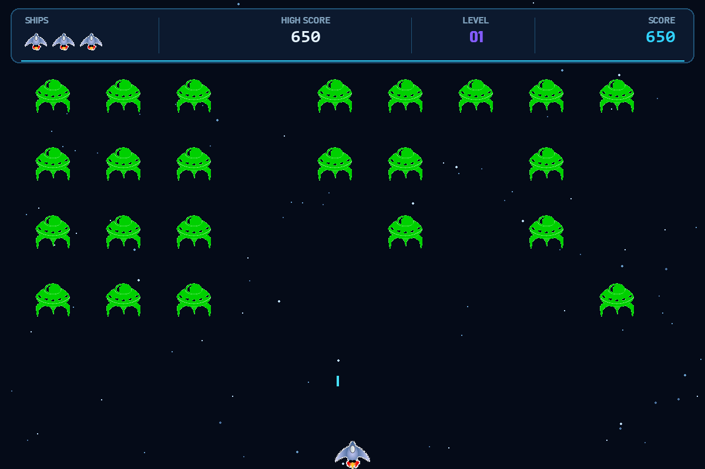

<div align="center">
  <h1>👾 Alien Invasion</h1>
  <p><strong>A small arcade game and my personal playground for learning Pygame.</strong></p>
  
</div>

## About the project

Alien Invasion is a classic fixed-screen shooter built with Python and Pygame. I made it as a fun project for experimenting with game loops, sprites, collisions, input handling, sound, UI design, and packaging a Python game as a desktop executable.

Move the ship, clear the fleet, and survive as long as possible. Every completed wave increases the level, speeds up the game, and makes each alien worth more points.

### Highlights

- Progressive alien fleets with increasing speed
- Score, session high score, level, and remaining-life HUD
- Keyboard and mouse controls
- Pause, restart, mute, and game-over states
- Generated arcade sound effects with silent fallback
- Frame-rate-independent movement and a procedural starfield

## Run locally

Python 3.12 is recommended. Clone the repository and enter the project directory:

```bash
git clone https://github.com/MRA-AK/alien_invasion_game.git
cd alien_invasion_game
python -m venv .venv
```

Activate the environment:

```powershell
# Windows PowerShell
.\.venv\Scripts\Activate.ps1
```

```bash
# macOS or Linux
source .venv/bin/activate
```

Install Pygame and launch:

```bash
python -m pip install -r requirements.txt
python alien_invasion.py
```

## Controls

| Action | Key |
| --- | --- |
| Move | Left/Right arrows or `A` / `D` |
| Fire | `Space` |
| Start or restart | `Enter` or click the button |
| Pause or resume | `P` or `Esc` |
| Mute or unmute | `M` |
| Quit | `Q` or close the window |

## Development

Install the development tools and run the test suite:

```bash
python -m pip install -r requirements-dev.txt
python -m pytest -q
```

Build the single-file Windows executable with:

```powershell
python -m PyInstaller --clean --noconfirm alien_invasion.spec
.\dist\AlienInvasion.exe
```

## License

This project is available under the [GNU General Public License v3.0](LICENSE).
